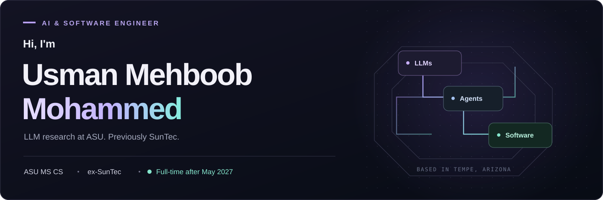

  

  <a href="https://usmanmehboobmohammed.com"><strong>My website</strong></a>
  &nbsp; · &nbsp;
  <a href="https://www.linkedin.com/in/mohammedusmanmehboob/"><strong>LinkedIn</strong></a>
  &nbsp; · &nbsp;
  <a href="https://usmanmehboobmohammed.com/projects"><strong>Projects and demos</strong></a>

## About me

I'm Usman, a Computer Science master's student at **Arizona State University**, graduating in **May 2027**. My current GPA is **4.00/4.00**. I'm also a Research Intern in the Cognition and Intelligence Lab, advised by **Prof. Chitta Baral**, where I work on LLM post-training and evaluation.

Before ASU, I spent **2 years 9 months at SunTec** working on financial software with Java, Spring Boot, SQL, Docker and AWS. These days, most of my work involves LLMs, agents and retrieval, along with the APIs and interfaces needed to use them.

## What I've worked on

- At ASU, I worked on Qwen3-4B GRPO training on four A100 GPUs. I corrected loss scaling and EOS masking, and debugged an FSDP deadlock caused by empty micro-batches. Model FLOPs utilization went from **9% to 21%** across five comparable configurations.
- I prepared **6,413 GSM8K preference pairs**, checking the final numeric answers and keeping the negative examples traceable. In separate work, I fine-tuned Qwen3.5-4B with rank-16 LoRA on **25,627 reasoning examples**.
- At SunTec, I helped move legacy components into **4+ Java/Spring Boot microservices**. I also reduced generation time by **33%** for a workflow covering **10M+ customer pricing reports**, through parallel processing, caching and SQL optimization. I received the **CTO Spot Award** for the migration work.

## Projects

<table>
<tr>
<td width="50%" valign="top">

### OwnStack

A local app for reviewing access changes and code patches. I worked on keeping tenants separate, requiring approval for the exact change, checking generated artifacts and recovering from worker failures.

Python · FastAPI · LangGraph · PostgreSQL · React/TypeScript

[Code](https://github.com/usmanmohammed2306/OWNSTACK)

</td>
<td width="50%" valign="top">

### MultiplexRAG

I built a router that chooses between BM25, dense retrieval and a combination of both. On **324 NFCorpus validation queries**, MRR@10 improved from **0.5110 to 0.5270** over the strongest fixed retriever.

Python · BM25 · FAISS · Sentence Transformers · scikit-learn

[Code](https://github.com/usmanmohammed2306/MultiplexRAG)

</td>
</tr>
<tr>
<td width="50%" valign="top">

### TabRL

A team project that turns text into structured tables. I led the two-stage pipeline: first generate a schema, then fill the table. I implemented and trained both Llama 3.1 8B LoRA stages and published two checkpoints.

PyTorch · VERL · FSDP · FlashAttention-2 · vLLM

[Team repository](https://github.com/tboliset/TabRL)

</td>
<td width="50%" valign="top">

### PRAXIS

I built a procedural-memory controller that retrieves useful tool-use guidance from earlier agent runs. It includes privacy redaction, checks before actions that change state, and safeguards to keep test data out of the memory bank.

Python · BM25 · TF-IDF · tau-bench · BFCL

[Code](https://github.com/usmanmohammed2306/PRAXIS)

</td>
</tr>
<tr>
<td width="50%" valign="top">

### IntentCart

A local planner for putting together a workstation from a small catalog. It flags missing information and repairs plans when requirements change. In a **384-goal synthetic evaluation**, it recovered all **73 minimum-cost feasible baskets**. PayPal sandbox checkout needs explicit approval.

Python · FastAPI · SQLite · JavaScript · Three.js

[Code](https://github.com/usmanmohammed2306/IntentCart)

</td>
<td width="50%" valign="top">

### AutoFrame

Irish Mehta and I built a photography assistant for our Advances in Robot Learning class, under Prof. Heni Ben Amor. It uses vision-language reasoning, an Android camera and a three-axis rig to adjust a shot. We evaluated it across **28 autonomous sessions**.

Python · FastAPI · Gemini · Android · ESP8266

[Team repository](https://github.com/IrishMehta/AutoFrame)

</td>
</tr>
</table>

These are local or research projects. The repositories describe how they work, how they were evaluated and what is still unfinished.

## What I use

**AI and research:** Python, PyTorch, VERL, vLLM, LoRA, GRPO, RAG, LangGraph  
**Software:** Java, Spring Boot, FastAPI, React, TypeScript, SQL, PostgreSQL, Docker, AWS

I've also been working on [Relief Atlas](https://github.com/usmanmohammed2306/relief-atlas), an app for coordinating everyday help among family and friends, and [FORGE](https://github.com/usmanmohammed2306/FORGE), a toolkit for recording and checking AI systems experiments.

---

I'm looking for **US full-time AI/ML engineering or software engineering roles on AI product teams after May 2027**. I'm also open to backend and full-stack work where my experience fits, and to relocating within the US.

You can find my resume and demos on [my website](https://usmanmehboobmohammed.com), or reach me on [LinkedIn](https://www.linkedin.com/in/mohammedusmanmehboob/).
